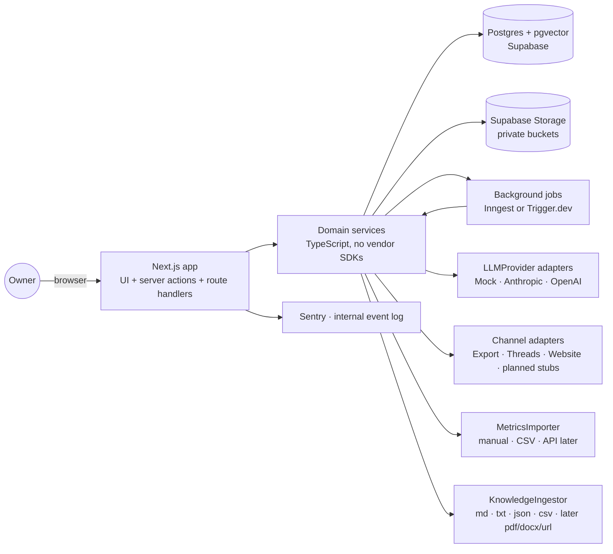
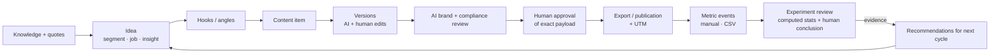
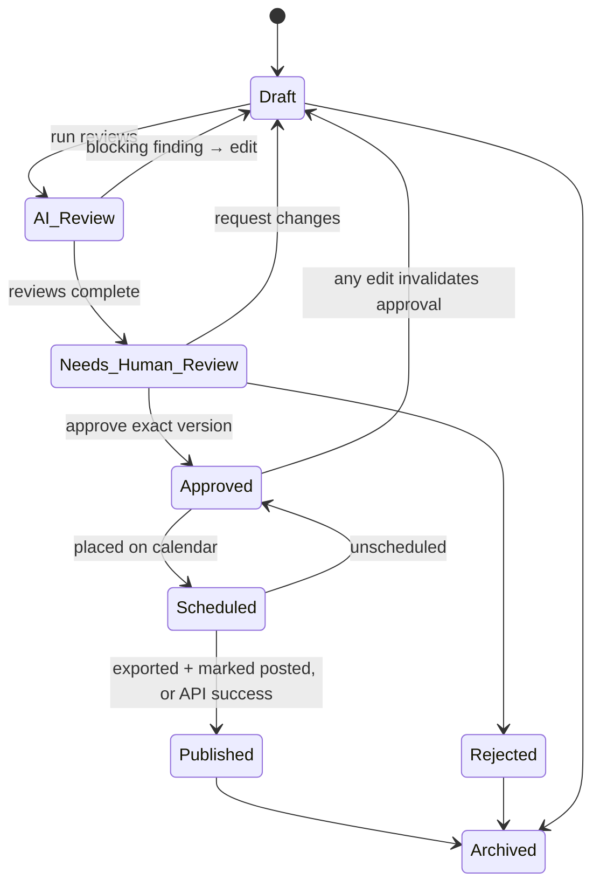
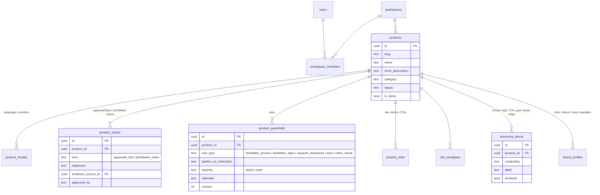
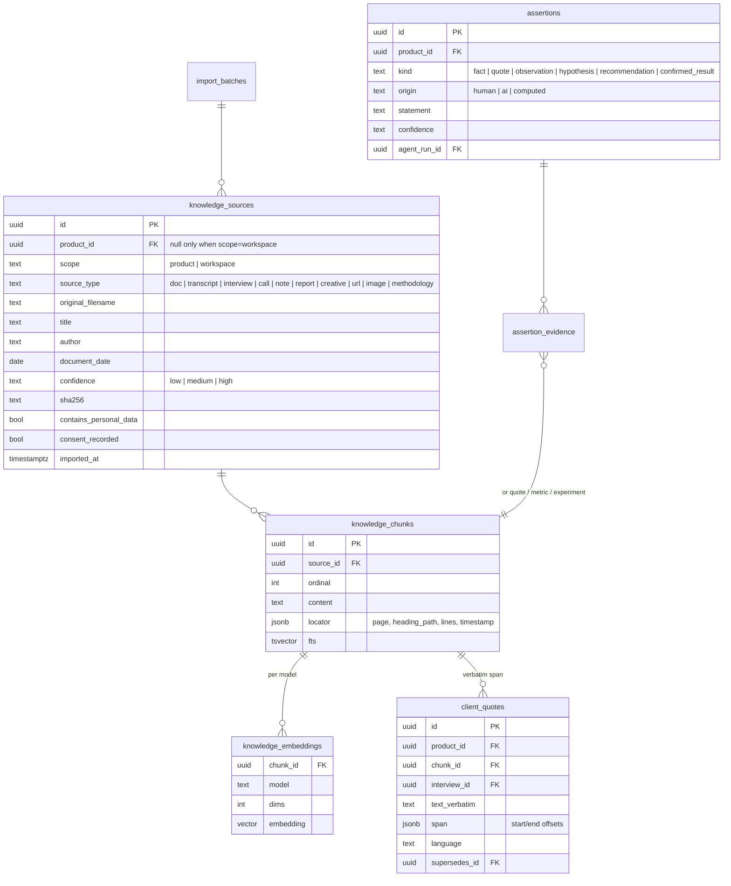
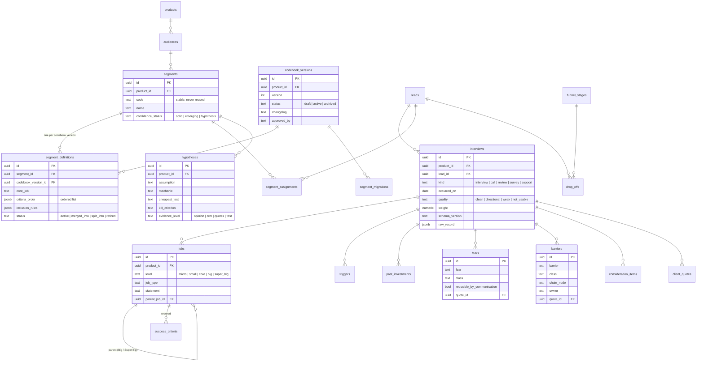
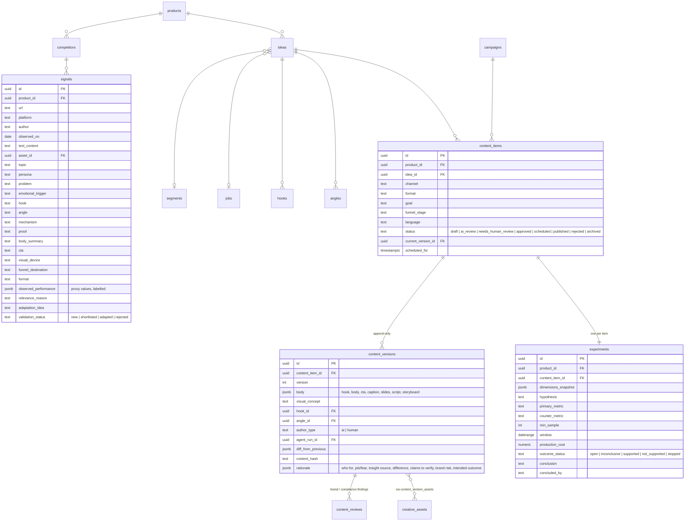
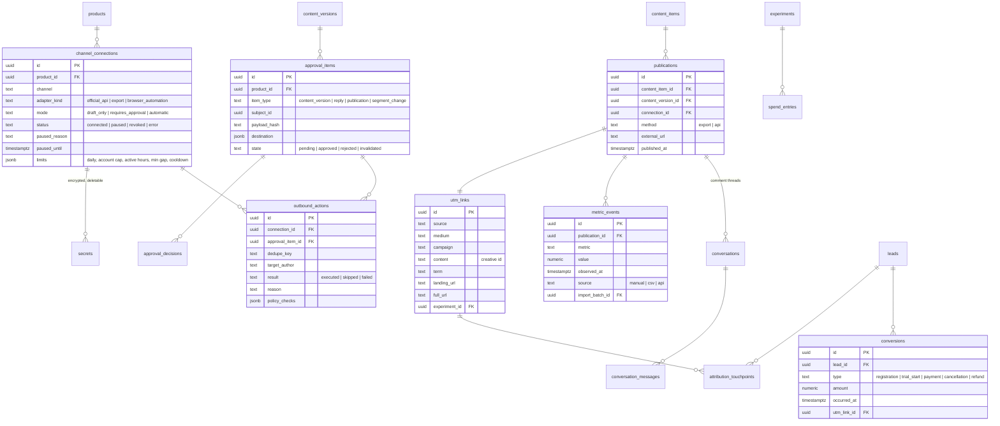
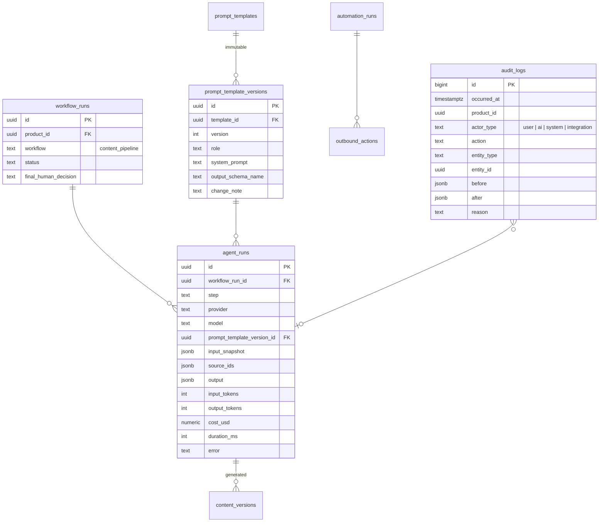

# Product architecture — Marketing OS

Stage A · 2026-10-19 · status: **proposal, awaiting owner approval**. No migrations or application code will be written until this document is approved.

## 1. Design principles

1. **One system, one memory.** Every decision (idea, hook, version, approval, publication) and every outcome (metrics, conversions, conclusion) lives in one Postgres database, linked by ids. No disconnected bots.
2. **Product isolation by construction.** Every product-scoped row carries `product_id`; cross-product references are impossible at the database level, not only in the UI.
3. **Epistemic honesty.** Every statement shown to the owner has a status: fact, verbatim quote, observation, hypothesis, recommendation or confirmed result. AI output defaults to *hypothesis*.
4. **Code counts, models write.** Numbers, shares, intervals and winners are computed by code. Models may only reference computed values.
5. **Humans own irreversible actions.** No external action (publish, comment, reply) without a recorded human approval of the exact payload. `automatic` mode exists in types only and is refused by the policy engine in the MVP.
6. **Adapters at every edge.** AI providers, channels, metrics sources, knowledge parsers, research sources and asset generators are interfaces. Business logic never imports a vendor SDK.
7. **Honest integrations.** A channel without a working adapter is shown as *planned*, never as connected. Mock and demo data are visibly labelled.
8. **Append-only history.** Content versions, quotes, metric events, approvals and audit logs are never updated in place.

## 2. System context



## 3. Technology choices

| Concern | Choice | Why |
|---|---|---|
| Web framework | Next.js (App Router), TypeScript `strict`, server actions + route handlers | As requested; one deployable for UI and API |
| Database | PostgreSQL via Supabase (local Supabase in Docker for Stage B; EU-region project for Stage C) | Relational integrity, RLS, pgvector in the same database |
| Data access | Drizzle ORM for typed queries; SQL migrations committed to the repo; RLS policies and triggers in hand-written SQL migrations (D-3) | Typed code, reviewable SQL, no lock-in to Supabase-specific runtime |
| Auth | Supabase Auth; single owner; email magic link + TOTP MFA (D-11) | Simple, secure |
| Files | Supabase Storage, private buckets, signed URLs with short expiry | Knowledge files and creative assets |
| Search | Postgres full-text search + pgvector, hybrid ranking | No extra infrastructure |
| Jobs | Inngest (recommended) or Trigger.dev (D-2) | Embeddings, CSV imports, AI runs, scheduled health checks |
| Validation | Zod schemas shared by forms, server actions, AI structured outputs and importers | One schema per entity |
| UI | Tailwind CSS + shadcn/ui, custom design tokens | Calm, consistent components |
| Errors | Sentry (server + client), PII scrubbing on | |
| Product analytics | Internal `app_events` table first (no third party sees customer data); PostHog optional later | Health data sensitivity |
| Tests | Vitest (unit), integration tests against local Postgres (RLS, isolation, triggers), Playwright (desktop + mobile viewports) | |

## 4. Module boundaries

```
src/
  app/                      routes; one folder per navigation section; no business logic
  components/               UI only
  domain/                   pure business logic, framework-free, unit-tested
    products/  knowledge/  ajtbd/  research/  content/  experiments/
    approvals/ distribution/  analytics/  utm/  guardrails/  audit/
  adapters/                 implementations of the interfaces in §10
    llm/ (mock, anthropic, openai)   channels/ (export, threads, website, planned/*)
    metrics/ (manual, csv)   ingest/ (markdown, text, json, csv)   research/ (manual)
  server/                   repositories (Drizzle), RLS-aware DB client, secrets, jobs
  workflows/                the sequential content pipeline (§8)
  lib/                      zod schemas, stats, dates, ids
db/
  migrations/               SQL, numbered
  seed/demo/                demo data, clearly flagged is_demo = true
  seed/back-app/            Back App configuration (guardrails, claims) — real, not demo
tests/
```

Rule: `domain/` may not import from `adapters/`, `app/` or any vendor SDK. Adapters depend on domain interfaces, not the other way round.

## 5. Tenancy and product isolation

- `workspaces` → `products`. MVP: one workspace, one owner; the schema supports more later.
- Every product-scoped table has `workspace_id` and `product_id NOT NULL`.
- **Composite foreign keys** prevent cross-product references. Each product-scoped table has `UNIQUE (id, product_id)`, and children reference `(parent_id, product_id)`. Example: a content item cannot point at a segment of another product because `FOREIGN KEY (segment_id, product_id) REFERENCES segments (id, product_id)` would fail.
- **Row-level security** on every table: a row is visible only to members of its workspace.
- **Repository layer** always requires an explicit `productId` argument for product-scoped reads; there is no "list all" across products except on the Products page and the workspace-level Activity Log filter.
- Workspace-level knowledge (methodology notes) has `scope = 'workspace'` and `product_id NULL`; customer evidence (quotes, interviews, metrics) is always product-scoped and cannot be workspace-scoped (check constraint).
- Isolation is covered by integration tests (DoD #2).

## 6. Epistemic model: facts, quotes, hypotheses

Two mechanisms:

1. **Typed source entities** that are factual by nature: `client_quotes` (verbatim, immutable), `metric_events` (observed numbers with source), `product_claims` (approved facts).
2. **`assertions`** — any statement produced or entered (insight, conclusion, recommendation) with:
   - `kind`: `fact | quote | observation | hypothesis | recommendation | confirmed_result`
   - `origin`: `human | ai | computed`
   - `confidence`: `low | medium | high` (qualitative; no invented percentages)
   - `assertion_evidence` rows linking to `knowledge_chunks`, `client_quotes`, `metric_events`, `experiments` or computed analysis snapshots, each with a locator (page, timestamp, line range).

Rules enforced in code and constraints:

- AI-originated assertions are inserted as `hypothesis` or `recommendation` only.
- `fact` requires at least one evidence link to a source with `confidence >= medium` or to an approved `product_claim`.
- `quote` requires a `client_quote` link and the text must match the quote exactly.
- `confirmed_result` can only be set by a human on a concluded experiment that had a pre-registered primary metric; the decision is audited.
- The UI shows the status as a small label on every statement and lists sources on hover/expand (DoD #4).

## 7. Data Flywheel: the experiment as the unit of learning



- **Every content item gets an `experiment` at creation.** The experiment snapshots its dimensions (product, audience, segment, job, insight source, quote, channel, format, topic, angle, hook, CTA, visual concept, funnel stage, goal, language). Re-tagging later is a new audited event.
- **Pre-registration:** primary metric, counter-metric, measurement window, minimum sample, hypothesis text. Editable until first publication, then locked.
- Generation provenance (model, prompt template version, agent run) and editing history (who changed what, diff) live on `content_versions`.
- Publication stores the exact text, media references, destination, UTM link and timestamps.
- Metrics arrive as `metric_events` (append-only snapshots per publication per metric per observed time, with source and import batch).
- Costs: `production_cost` on the experiment; ad spend as `spend_entries` (date, amount, currency, campaign/experiment).
- Conclusion: computed summary (frozen snapshot) + human-written outcome and status (`inconclusive | supported | not_supported | stopped`).
- Recommendations (§13) are generated only from concluded or in-window experiments and cite them.

## 8. AI workflow (MVP: sequential, not autonomous)

The 13 responsibilities from the brief are **roles** (prompt templates + Zod output schemas + step handlers), not agents. MVP pipeline:

| Step | Role(s) | Input | Output | Human gate |
|---|---|---|---|---|
| 1 Knowledge selection | Researcher | product, query, filters | ranked chunks + quotes (owner ticks which to use) | owner selects sources |
| 2 Audience & Job | Audience / AJTBD Analyst | selected segment + job | brief: who, job, criteria order, fears, barriers | owner confirms |
| 3 Hooks & angles | Hook Analyst, Content Strategist | brief + past experiment stats | 3–5 hook/angle variants with rationale | owner picks |
| 4 Content generation | Creator | chosen hook + format + channel | variants per format | — |
| 5 Brand review | Brand Editor | variant + tone rules + examples | findings (structured) | — |
| 6 Compliance review | Compliance Editor (deterministic rules + model) | variant + guardrails + claims | findings; blocking or warning | blocking findings require edit |
| 7 Human approval | Human Approver | exact payload + destination | approve / reject / request changes | **always** |
| 8 Export or publish | Publisher | approved version | export package or API call through policy engine | — |
| 9 Metrics import | Performance Analyst (code) | CSV / manual | metric events | owner confirms mapping |
| 10 Experiment review | Performance Analyst | computed stats | conclusion draft (hypothesis) | owner writes final conclusion |

Each step is a `workflow_step` row; each model call is an `agent_run` with: input snapshot, selected source ids, prompt template version, provider and model, raw output, parsed output, tokens, cost, duration, errors, retries. Manual edits and the final human decision are linked to the same workflow run. Per-run and per-day cost caps abort runs that would exceed budget.

Prompt-injection stance: knowledge chunks, signals and comments are inserted into prompts inside clearly delimited data blocks; generation steps have no tools and no network; outputs are schema-validated and always reviewed by a human before leaving the system.

## 9. Content lifecycle and approval



- **Approval binds to a version hash** (text + media + destination + UTM). Editing creates a new version and invalidates the approval automatically.
- One unified **Approval Queue** holds `approval_items` of types: content version, comment/reply draft, publication action, segment/codebook change. Each shows exactly what will be sent, where (channel, account, target URL) and why it is in the queue.
- For export-only channels, "Published" is set when the owner marks the item as posted and pastes the post URL (needed for metrics).

### Action policy engine (Comments Factory patterns, independent implementation)

`evaluate(action) → { allowed: boolean, reason: string, checks: Check[] }`. Checks, in order:

1. Global red lines (hard-coded, not configurable in MVP): mode `automatic` refused; no action without approval of the same version hash; AI may not impersonate a customer (compliance flag).
2. Connection status: connected, not revoked, not paused (circuit breaker with reason and expiry).
3. Mode: `draft_only` → never sends; `requires_approval` → needs approval.
4. Active hours (audience time zone), daily limit, account-wide cap, minimum gap.
5. Dedupe key (one action per target post), author cooldown, stop-list.
6. Promotion share warning (product mention / link share over last N).

Every evaluation is stored on `outbound_actions` with the reason, so skipped and executed actions both have visible reasons. Any adapter error classified as `captcha | restriction | auth_lost | rate_limited` pauses the connection immediately.

## 10. Interfaces (adapters)

```ts
// LLM — business logic asks for structured output, never for a vendor.
interface LLMProvider {
  id: string;                                  // 'mock' | 'anthropic' | 'openai' | ...
  generate<T>(req: {
    task: string;                              // role/step name, for routing and logging
    system: string; input: string;
    schema: ZodType<T>;                        // structured output, validated
    model?: string; maxTokens?: number; temperature?: number;
  }): Promise<{ output: T; raw: string; usage: { inputTokens: number; outputTokens: number };
                costUsd: number | null; model: string; latencyMs: number }>;
  embed?(texts: string[], model?: string): Promise<{ vectors: number[][]; model: string; dims: number }>;
}

interface ChannelConnector {
  channel: ChannelId;                          // 'instagram' | 'threads' | 'website' | 'youtube' | ...
  capabilities: { export: boolean; publish: boolean; reply: boolean; metrics: 'none' | 'manual' | 'api' };
  status: 'available' | 'planned';             // planned adapters cannot be connected
  connect(ctx): Promise<ConnectionResult>;     // OAuth or credentials, stored encrypted
  disconnect(connectionId): Promise<void>;     // revoke + delete secrets; history retained
  health(connectionId): Promise<HealthReport>;
}

interface Publisher {
  channel: ChannelId;
  validate(payload: PublishPayload): ValidationResult;   // length, media specs, links, UTM
  preview(payload: PublishPayload): PreviewModel;        // exactly what will be sent and where
  exportPackage?(payload: PublishPayload): Promise<ExportFile[]>;
  publish?(payload: PublishPayload, ctx: ApprovedActionContext): Promise<PublishResult>; // only via policy engine
}

interface MetricsImporter {
  source: 'manual' | 'csv' | 'api';
  describeMapping(file?: Buffer): Promise<ColumnMapping>;   // owner confirms mapping
  import(input, mapping): Promise<ImportResult>;           // creates import_batch + metric_events
}

interface KnowledgeIngestor {
  accepts: string[];                                        // mime types / extensions
  parse(file: StoredFile, meta: ProvenanceInput): Promise<ParsedDocument>; // text + locators
}

interface ResearchProvider {                                // MVP: manual entry only
  id: string;
  fetchSignals?(query: ResearchQuery): Promise<SignalDraft[]>;
}

interface AssetGenerator {                                  // MVP: none implemented
  id: string;
  generate(brief: AssetBrief): Promise<GeneratedAsset>;
}
```

Channel registry in MVP: **Instagram** (export only), **Facebook Page** (export only), **Threads** (export/copy; official API publishing is decision D-7), **Website** (UTM destinations + article export), and **planned** stubs for YouTube, TikTok, X, LinkedIn, Snapchat, Pinterest, Blog/SEO, Email — each displayed as "Planned, not connected". A **browser-automation adapter** is not built; the type `adapterKind: 'official_api' | 'export' | 'browser_automation'` exists so that any future one is labelled and gated with a risk disclosure.


### 10.1 Paid advertising (owner decision 2026-10-19)

Marketing OS manages **paid campaigns as well as organic content**: Meta Ads (Facebook + Instagram) and Google Ads first, others later. Paid ads use the same flywheel: an ad creative is a `content_item` with an `experiment`; spend and results attach to it.

```ts
interface AdsConnector {
  platform: 'meta_ads' | 'google_ads' | 'tiktok_ads' | 'linkedin_ads' | ...;
  capabilities: { importCsv: boolean; readApi: boolean; writeApi: boolean };
  importReport(file | apiQuery): Promise<AdsImportResult>;     // campaigns, ad sets/groups, ads, daily spend + results
  proposeChange?(change: AdsChange): Promise<AdsChangePreview>; // pause, budget, new ad — preview only
  applyChange?(change: AdsChange, ctx: ApprovedActionContext): Promise<AdsChangeResult>; // via policy engine, after approval
}
```

New tables: `ad_accounts`, `ad_campaigns`, `ad_groups` (ad set / ad group), `ads` (linked to `content_items` / `creative_assets` and `utm_links`), `ad_daily_stats` (append-only, per ad per day: spend, impressions, clicks, platform conversions, currency), `ad_change_requests` (proposed change → approval → result). `spend_entries` is fed from `ad_daily_stats`.

Rules: platform-reported conversions are stored as **platform claims**, separate from our own conversions; every write (pause, budget, launch) goes through the Approval Queue and policy engine; automatic rules (kill / test / scale from the course guide) are proposals only until v0.8.

## 11. Knowledge base and search

1. Upload → private Storage → `knowledge_sources` row with provenance: original filename, title, author, document date, source type, product, scope, confidence, import date, sha256 (dedupe), uploader, consent flag for customer data.
2. Parse via `KnowledgeIngestor` (MVP: Markdown, TXT, JSON, CSV; later PDF, DOCX, URL, images with OCR, transcripts with timestamps).
3. Chunk by structure (headings, paragraphs, JSON paths, CSV rows) with locators: heading path, line range, page, timestamp.
4. Embeddings computed by a background job into `knowledge_embeddings (chunk_id, model, dims, vector)` — separate table so the embedding model can change without losing chunks.
5. Hybrid search: full-text rank + vector similarity, filtered by product and scope. Results always return source + locator.
6. Customer quotes are extracted **by a human selecting text** in a source (MVP), stored verbatim with source and offsets; AI-suggested quotes are verified by exact string match against the chunk before they can be saved.

### 11.1 Methodology knowledge base (course materials)

The AI Mindset course vault and the AJTBD files are the **methodological foundation** of the system (owner decision, 2026-10-19). They are kept apart from customer evidence:

| Layer | Scope | Examples | May support |
|---|---|---|---|
| **Methodology** | workspace (all products) | course cards, transcripts, materials, AJTBD pipeline, schema, codebook template | playbook rules, prompt instructions, review checklists, recommendations ("why this approach") |
| **Product evidence** | one product | interviews, reviews, analytics exports, approved facts | facts, quotes, segments, jobs, experiment results |

- **Playbook:** `playbook_rules` (versioned, owner-approved) distil the methodology into operational rules — e.g. "a flywheel exists only if outcomes change the next decision", "criteria order defines a segment", "never count with the model", "tag creatives by persona/hook/angle/format/CTA". Each rule links to its source chunks, has a `kind` (`principle | checklist_item | creative_formula | review_rule | anti_pattern`), and per-product applicability (a product can mark a rule *not applicable*, e.g. FOMO tactics for Back App).
- Generation and review steps retrieve relevant playbook rules **and** product evidence separately; the prompt labels them differently, and outputs cite both.
- Methodology chunks can never be linked as evidence for an assertion of kind `fact`, `quote` or `confirmed_result` about a product (check constraint on `assertion_evidence` via source scope).
- Import pipeline for the vault: decode filenames → parse front-matter (session id, title, date, speaker, type) → classify file (card / transcript / chat / material / pdf) → pseudonymise participants (deterministic map stored encrypted) → chunk (cards by topic headings, transcripts by timestamped blocks, materials by headings) → embed. Raw files are kept in a private Storage bucket, not in Git.
- Language: the methodology is in Russian while content may be produced in other languages, so the embedding model must be multilingual (D-5).

## 12. AJTBD module

Universal entities, no example-company content:

- `interviews` (call/interview/review/survey/support conversation; date, type, consent, transcript source, usability gates, quality and weight, diarization flag, schema version, raw JSON record if imported).
- `leads` — a pseudonymous person record (no names required) used by both research and conversions; segment assigned to the lead, not the interview.
- `jobs` with `level` (`micro | small | core | big | super_big`), `job_type` (`regular | orientation | tax | fake | emotional | viral`), parent job, statement ("want + verb"), grammar check result.
- `success_criteria` (direction, threshold, concrete, source `self | echoed | prompted_by_interviewer`, quote) with `priority_rank` per interview.
- `triggers` (event, kind, date, quote), `past_investments`, `consideration_items` (slot: known way / comparison / named product / fear by way).
- `fears` (class, about way, reducible by communication, source, quote) and `barriers` (class, chain node, owner, quote) — separate tables.
- `client_quotes` — verbatim, immutable (update blocked by trigger; corrections create a new quote that supersedes).
- `codebook_versions` (status `draft | active | archived`, approved by, approved at, changelog), `segments` (stable id, never reused), `segment_definitions` (per codebook version: Core Job, ordered criteria, inclusion/exclusion rules, status), `segment_migrations` (old → new, operation, recalculation rule), `segment_assignments` (lead → segment, codebook version, rule matched, confidence, assigned by).
- `funnel_stages`, `drop_offs` (stage, mode `interruption | switch | barrier | value_insufficient`, switched to), `hypotheses` (RAT card).
- **Per-product custom causal fields** (`profile_field_definitions`) replace the Germany-specific fields.
- Every change to segments and codebooks is audited; segment ids are immutable; an active codebook version is read-only.
- Aggregates (segment shares, criterion #1 distribution, confidence) are SQL views; cells with N below the threshold return `not_enough_data`.

## 13. Analytics, statistics and recommendations

- Metric definitions are code (`analytics/metrics.ts`): reach, views, engagement (saves + shares + comments + likes, configurable), clicks, registrations, trial starts, paid, cancellations/refunds, conversion rates, CPL and CAC (only when spend exists).
- Group-by dimensions: product, channel, segment, hook, angle, format, CTA (and topic, language).
- **Winner logic:** never declare a winner unless both groups meet minimum sample thresholds (D-10) and the Wilson 95% intervals for the rate do not overlap. Otherwise the cell shows `Not enough data` or `Directional, not significant`.
- Observational data (organic posts) can produce at most an `observation` or `hypothesis`. Only an experiment designed with comparable arms and concluded by the owner can become `confirmed_result`.
- **Recommendation card** (generated text is bounded by computed facts): data used (experiment ids), sample size, measurement period, facts (computed values), hypotheses (AI, labelled), proposed next action, metric that would confirm/reject, exploration note (untested combinations).
- Attribution: UTM builder generates one link per publication (`utm_source`, `utm_medium`, `utm_campaign`, `utm_content` = creative id, `utm_term`), plus internal ids (product, channel, experiment). Conversions are imported (CSV) with UTM or link id and matched in code; unmatched rows are reported, never guessed. For a mobile app the website landing page captures UTM before the store; see risk R-4.

## 14. Security

- Secrets (API keys, OAuth tokens) only server-side, in a `secrets` table encrypted with AES-256-GCM envelope encryption; the master key lives in server environment / KMS, never in the database or the browser (D-4). Each secret has `key_version` for rotation; a rotation job re-encrypts.
- Never in `localStorage`, cookies (except the auth session cookie), logs, Sentry events or AI prompts. Logger and Sentry use a redaction list.
- Disconnecting a connection revokes the token at the provider where supported, deletes the ciphertext, sets `status = revoked`; publications, outbound actions and metrics keep their `connection_id` (FK `ON DELETE RESTRICT`, rows never deleted) — DoD #15.
- Integration status page: per connection status, scopes, last health check, last error, paused-until and reason, last rotation.
- RLS on every table; service-role key only in background jobs, never in request handlers that render user data.
- Customer data: consent flag on interviews, pseudonymous lead ids, optional redaction of names/phones/emails before text is sent to an AI provider (D-15).
- Security headers, CSRF protection via server actions, rate limiting on auth and upload routes, file type and size validation on upload.

## 15. Audit and activity log

`audit_logs` is append-only (UPDATE/DELETE revoked; trigger rejects them): `occurred_at, workspace_id, product_id, actor_type (user | ai | system | integration), actor_id, action, entity_type, entity_id, before, after, diff, reason, request_id, agent_run_id`. Every external action, approval, status change, import, segment/codebook change, connection change and AI run writes an entry. The Activity Log page filters by product, actor, entity and action.

## 16. Interface architecture

- Persistent header: **product selector** (always visible, also shows product colour chip), global search, approval queue counter, integration status dot.
- Left navigation (19 sections from the brief). Sections without MVP functionality render an honest empty state ("Planned for v0.x") rather than fake data.
- The selected product is part of the URL (`/p/{productSlug}/…`) so links never show another product's data.
- **Overview answers in five seconds:** selected product (header); "Needs your attention" list (blocking compliance findings, approvals waiting, paused connections, experiments past their window without conclusion); approval queue count; next 7 days scheduled; last 7 days published; best-performing items with sample-size labels; integration problems.
- Visual language: warm off-white background, graphite text, deep green primary, soft sage secondary, one accent for warnings; status shown with small labelled dots, not coloured cards; generous spacing; tables as the primary data view; responsive down to 375 px.

## 17. Entity–relationship model

The model is split into six domains for readability. Every product-scoped table also has `workspace_id`, `created_at`, `created_by`, and (unless append-only) `updated_at`; these are omitted from the diagrams. `PK` = primary key, `FK` = foreign key.

### 17.1 Tenancy and product profile



### 17.2 Knowledge and evidence



### 17.3 Audience and AJTBD



### 17.4 Research, ideas and content



### 17.5 Distribution, conversations and measurement



### 17.6 AI runs, automation and audit



### 17.7 Table catalogue

Required by the brief (all present): users, workspaces, products, product_locales, product_claims, product_guardrails, audiences, segments, codebook_versions, jobs, fears, barriers, client_quotes, knowledge_sources, knowledge_chunks, competitors, signals, hooks, angles, content_items, content_versions, creative_assets, campaigns, experiments, channel_connections, publications, conversations, approval_items, metric_events, attribution_touchpoints, leads, conversions, prompt_templates, agent_runs, automation_runs, audit_logs.

Added and why:

| Table | Reason |
|---|---|
| workspace_members | Owner today, roles later |
| product_links, utm_templates, brand_profiles, taxonomy_terms | Profile fields from §6; controlled vocabularies make "performance by CTA/format/topic" reliable |
| import_batches | Provenance and rollback of every import |
| knowledge_embeddings | Change embedding model without re-chunking |
| assertions, assertion_evidence | Fact/quote/hypothesis labelling with sources |
| interviews, success_criteria, triggers, past_investments, consideration_items | AJTBD entities from §8 |
| segment_definitions, segment_migrations, segment_assignments | Versioned codebook, migration map, one lead → one segment |
| funnel_stages, drop_offs, hypotheses | Funnel stage, drop-off point, RAT hypotheses (§8) |
| profile_field_definitions | Per-product causal fields instead of hardcoded ones |
| ideas | "Create one content idea" (Stage C) before hooks and items |
| playbook_rules, playbook_rule_sources, product_rule_overrides | Course methodology turned into versioned, cited, owner-approved rules; per-product applicability |
| content_reviews | Structured brand/compliance findings per version |
| content_version_assets | Many-to-many versions ↔ creative assets |
| approval_decisions | Who decided what, when, on which hash |
| outbound_actions | Every attempted external action with policy result and reason |
| utm_links | Unique link per publication |
| spend_entries | Ad spend for CPL/CAC |
| conversation_messages | Individual comments/replies inside a thread |
| secrets | Encrypted credentials separate from connection metadata |
| prompt_template_versions, workflow_runs | Immutable prompt versions; grouping of agent runs |
| app_events | Internal product analytics without third parties |

## 18. Major design decisions (summary)

| # | Decision | Alternatives considered | Why |
|---|---|---|---|
| ADR-1 | Single Postgres with pgvector; no separate vector DB | Pinecone, Weaviate | Fewer moving parts; joins between evidence and content |
| ADR-2 | Composite FKs + RLS for product isolation | App-level filtering only | Mistakes become impossible, not just unlikely |
| ADR-3 | One experiment per content item, snapshot of dimensions | Experiments only for A/B tests | Brief requires every item to be an experiment; snapshots prevent back-filling |
| ADR-4 | Append-only versions, metrics, quotes, audit | Mutable rows with `updated_at` | History of decisions is the product |
| ADR-5 | Approval bound to content hash | Approval bound to item | Editing after approval cannot slip through |
| ADR-6 | Roles as prompt templates in a sequential workflow | Autonomous multi-agent | Brief requires no autonomous agents in MVP; easier to audit and cost-control |
| ADR-7 | Deterministic guardrails block; AI reviews advise | AI-only review | Back App red lines must be caught every time; tested with a golden set |
| ADR-8 | Statistics and winners computed by code with sample thresholds | AI analysis | "Model does not count" |
| ADR-9 | Secrets encrypted at application level, separate table | Token columns on connections | Revocation = delete ciphertext; history keeps metadata |
| ADR-10 | Planned channels as declared stubs with `status = planned` | Not listing them | Architecture ready, UI honest |
| ADR-11 | Internal event log instead of a third-party analytics SDK | PostHog from day one | Sensitive health-adjacent data; can add later |
